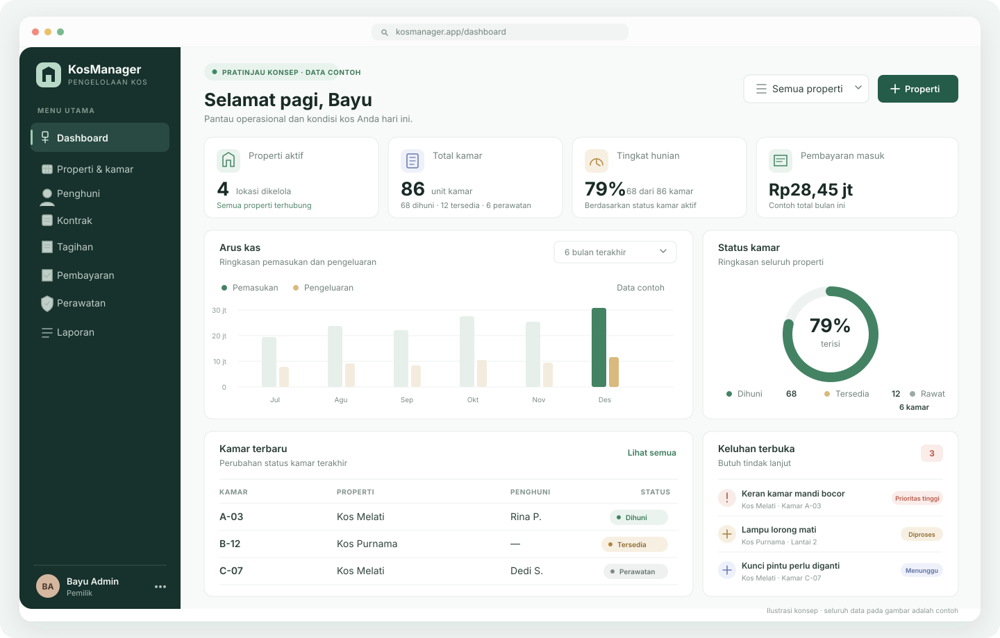

# KosManager

Sistem web manajemen kos multi-properti: properti, kamar, penghuni, kontrak, tagihan, pembayaran, meter utilitas, biaya, keluhan, dan laporan. UI Bahasa Indonesia, compact, dan responsive.

## Pratinjau dashboard



Gambar di atas adalah mockup visual. Aplikasi berjalan menggunakan data yang tersimpan di PostgreSQL setelah mengikuti setup di bawah.

## Fitur yang tersedia

- Registrasi, login, sesi, dan workspace pemilik.
- Pengelolaan akses pemilik, pengelola, keuangan, dan staf untuk akun yang sudah mendaftar.
- Paket Free (1 properti, 10 kamar, 3 anggota) dan Pro tanpa batas dengan pemeriksaan kuota di server.
- Permintaan upgrade Pro dan persetujuan admin manual dengan audit log.
- Isolasi query berdasarkan workspace dari sesi server.
- Permohonan sewa calon penghuni, keputusan pengelola, serta pembuatan profil dan kontrak secara atomik.
- Pencatatan properti, kamar, dan penghuni; status kamar bisa diperbarui.
- Edit properti, kamar, dan profil penghuni dengan audit log.
- Reset kata sandi dan email undangan anggota/penghuni melalui Resend setelah environment email disetel.
- Kontrak dengan validasi server dan penguncian kamar untuk mencegah tanggal aktif bertumpuk.
- Tagihan bulanan idempoten per kontrak dan periode.
- Pencatatan dan verifikasi pembayaran manual dengan pembaruan saldo invoice dalam transaksi.
- Catatan meter utilitas, biaya operasional, dan tiket perawatan dengan riwayat audit.
- Riwayat aktivitas workspace untuk menelusuri perubahan penting secara terurut dan terpaginasikan.
- Dashboard dan laporan pemasukan, biaya, tunggakan, serta okupansi dari database.
- Ekspor CSV untuk pemasukan, biaya, dan status kamar.
- Pencarian, filter, pagination server-side, serta filter periode/properti pada laporan.
- Bukti pembayaran dan foto keluhan disimpan privat di PostgreSQL; akses dilindungi sesi, peran, workspace, dan kepemilikan.
- Pengingat tagihan email terjadwal dengan konfigurasi hari sebelum/sesudah jatuh tempo dan pencatatan idempotent.
- Migration PostgreSQL tersimpan di `drizzle/`.

## Menjalankan secara lokal

### Kebutuhan

- Node.js 20.9 atau lebih baru.
- Docker Compose untuk PostgreSQL lokal, atau URL koneksi PostgreSQL/Neon sendiri.
- npm dan akses ke npm registry untuk mengunduh dependency.

### Langkah

```bash
git clone https://github.com/sulaksana23/KosManagement.git
cd KosManagement
cp .env.example .env.local
```

Buat secret lokal dan masukkan ke `BETTER_AUTH_SECRET` pada `.env.local`:

```bash
openssl rand -base64 32
```

Untuk database lokal, jalankan PostgreSQL:

```bash
docker compose up -d db
```

Kemudian install dependency, terapkan migration, dan jalankan aplikasi:

```bash
npm ci
npm run db:migrate
npm run test
npm run dev
```

Deployment Production Vercel menerapkan migration Drizzle yang belum dijalankan sebelum build aplikasi. Skrip ini hanya aktif saat `VERCEL_ENV=production`; Preview tidak mengubah database Production. Untuk migration lokal, jalankan `npm run db:migrate` secara manual. Pada Vercel, `BETTER_AUTH_URL` dan `NEXT_PUBLIC_APP_URL` Production harus memakai domain utama aplikasi; client auth memakai origin yang sedang dibuka.

Untuk email, tambahkan `RESEND_API_KEY` dan `EMAIL_FROM` setelah domain pengirim diverifikasi di Resend. Reset kata sandi, undangan, dan pengingat otomatis menggunakan konfigurasi ini. Endpoint `/api/cron/reminders` perlu `CRON_SECRET` acak minimal 32 karakter. `vercel.json` menjadwalkannya setiap hari pukul 00:00 UTC (08:00 WITA). Jika email belum dikonfigurasi, reset/undangan tetap menyediakan tautan yang bisa dibagikan, sedangkan reminder mencatat kegagalan dan akan mencoba lagi pada jadwal berikutnya.

Lampiran bukti bayar dan foto keluhan disimpan sebagai `bytea` di PostgreSQL, bukan Vercel Blob atau URL publik. Unggahan dibatasi 1,5 MB per gambar dan menerima JPEG, PNG, atau WebP. Pertimbangkan kapasitas database dan kebijakan backup bila volume file meningkat.

Buka `http://localhost:3000`, pilih **Daftar**, lalu buat workspace. Untuk memakai Neon secara lokal, isi `DATABASE_URL` dari dashboard Neon. Jika tersedia, isi juga `DATABASE_URL_UNPOOLED` untuk menjalankan migration melalui koneksi langsung.

Paket Free mencakup 1 properti, 10 kamar, dan 3 anggota (termasuk pemilik serta undangan aktif). Paket Pro membuka kuota tersebut tanpa batas. Untuk menerima permintaan upgrade Pro, tambahkan email admin ke `KOSMANAGER_ADMIN_EMAILS` pada environment aplikasi, lalu buka `/admin/plans`. Aktivasi saat ini ditinjau manual; pembayaran otomatis dan harga belum dikonfigurasi.

Untuk menambahkan staf: pemilik membuat undangan dari menu **Anggota**. Jika Resend sudah diatur, email dikirim otomatis; tautan tetap tersedia untuk disalin sebagai cadangan. Tautan hanya berlaku sekali selama 7 hari.

### Portal penghuni

Isi email pada profil penghuni, lalu pilih **Undang ke portal**. Jika Resend sudah diatur, undangan dikirim otomatis; tautan juga dapat disalin. Penghuni melihat kontrak, tagihan, riwayat pembayaran, dan tiket miliknya sendiri. Saat melaporkan pembayaran, penghuni dapat menyertakan foto bukti. Status tetap menunggu sampai petugas memverifikasinya di menu **Tagihan & bayar**. Foto keluhan juga bisa ditambahkan dari portal.

Pada menu **Pengingat**, pemilik/pengelola memilih berapa hari sebelum dan sesudah jatuh tempo email dikirim. Pastikan deployment menggunakan Vercel Cron dan environment email/rahasia cron telah diatur. Setiap pengiriman tercatat dan mencegah email ganda untuk tanggal pengingat yang sama.

### Data demo (opsional)

Set `SEED_OWNER_EMAIL` dan `SEED_OWNER_PASSWORD` di `.env.local`, lalu jalankan:

```bash
npm run db:seed
```

Seed hanya bisa berjalan saat `NODE_ENV` bukan `production`; akun dan datanya adalah contoh development.

## Perintah proyek

```bash
npm run dev         # server development
npm run build       # build production
npm run start       # server production
npm run lint        # pemeriksaan ESLint
npm run typecheck   # pemeriksaan TypeScript
npm run db:generate # buat file migration dari perubahan schema
npm run db:migrate  # terapkan migration tersimpan
npm run db:push     # sinkronisasi schema untuk development saja
```

## Batasan saat ini

Email memerlukan akun Resend, API key, dan domain pengirim yang diverifikasi. Scheduler aktif pada deployment Vercel setelah `CRON_SECRET` ditambahkan. Penyimpanan bytea menjaga file tetap privat di database, tetapi ukuran database dan backup akan meningkat sesuai jumlah lampiran. Satu akun hanya dapat terhubung ke satu workspace. Tanda tangan kontrak, QRIS/payment gateway, dan rekonsiliasi otomatis belum tersedia. Ikon UI memakai Lucide yang dirender sebagai SVG.

Jangan menaruh secret, password demo nyata, data penghuni, atau dokumen pribadi di GitHub.

## Dokumen

- [PRD](docs/PRD.md)
- [Flowchart](docs/FLOWCHART.md)
- [Arsitektur](docs/ARCHITECTURE.md)
- [Prompt implementasi](docs/IMPLEMENTATION-PROMPT.md)
- [Aturan agent](AGENTS.md)

## Pemeriksaan otomatis

Jalankan `npm run lint`, `npm run typecheck`, `npm test`, dan `npm run build` sebelum mengirim perubahan. GitHub Actions memakai PostgreSQL sementara untuk menerapkan migration dan mengetes isolasi workspace, lalu membangun aplikasi produksi. Tes unit mencakup aturan domain, password, pengingat, dan perhitungan transaksi; smoke test HTTP memeriksa halaman auth utama.
