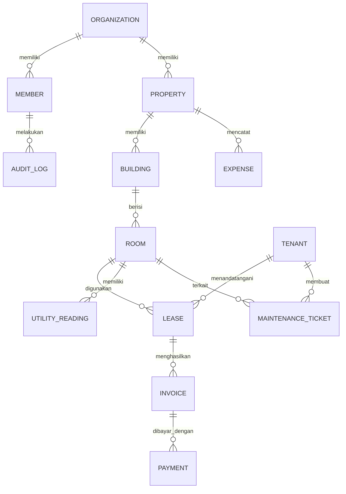

# KosManager — Product Requirements Document

> Dokumen kebutuhan produk untuk sistem manajemen kos multi-properti. Nama KosManager masih dapat diganti.

## 1. Ringkasan produk

KosManager adalah aplikasi web untuk pemilik dan pengelola kos yang menangani beberapa properti dari satu dashboard. Sistem mencakup kamar, penghuni, kontrak, tagihan, pembayaran, meter utilitas, biaya operasional, keluhan, dan laporan.

Aplikasi harus nyaman dipakai dari ponsel oleh pemilik maupun staf lapangan. Penghuni mendapat portal sederhana untuk melihat kontrak, tagihan, status pembayaran, dan mengirim keluhan.

## 2. Masalah dan tujuan

### Masalah pengguna

- Status kamar dan data penghuni tersebar di spreadsheet atau chat.
- Tagihan, pembayaran, dan tunggakan sulit dilacak.
- Pengeluaran listrik, air, perbaikan, dan operasional tidak tercatat rapi.
- Keluhan penghuni tidak memiliki status dan riwayat tindak lanjut.
- Pemilik beberapa kos sulit melihat tingkat hunian dan arus kas secara cepat.

### Tujuan produk

- Menyatukan operasional beberapa properti dalam satu sistem.
- Mengurangi pencatatan manual dan kesalahan tagihan.
- Mempercepat tindak lanjut pembayaran dan keluhan.
- Memberi pemilik ringkasan okupansi dan keuangan yang dapat ditelusuri ke transaksi.
- Menyediakan akses penghuni yang aman dan mudah dipakai di ponsel.

### Bukan tujuan MVP

- Menjadi marketplace kos publik dengan sistem rekomendasi kompleks.
- Menyimpan data kartu pembayaran.
- Mengklaim pembayaran berhasil hanya dari halaman redirect.
- Mengirim WhatsApp tanpa konfigurasi dan persetujuan penyedia yang sah.
- Mengganti akuntansi penuh perusahaan.

## 3. Pengguna dan hak akses

| Peran | Akses utama |
|---|---|
| Pemilik | Semua properti dan data dalam workspace miliknya; pengaturan anggota dan laporan |
| Pengelola | Properti, kamar, penghuni, kontrak, keluhan, dan operasional sesuai izin |
| Keuangan | Tagihan, pembayaran, biaya, rekonsiliasi, dan laporan keuangan |
| Staf | Kamar dan tiket perbaikan yang ditugaskan; tanpa akses ke data keuangan sensitif |
| Penghuni | Profil, kontraknya sendiri, tagihan, pembayaran, bukti bayar, dan tiket miliknya |

Hak akses harus dicek di server pada setiap operasi. Menyembunyikan tombol di UI saja bukan kontrol keamanan.

## 4. Ruang lingkup fitur

### P0 — Wajib untuk MVP

#### Akun dan workspace

- Registrasi/login, reset kata sandi, undangan anggota.
- Satu workspace dapat memiliki beberapa properti.
- Role dan izin anggota dapat dikelola pemilik.

#### Properti dan kamar

- Data properti, alamat, aturan, fasilitas, gedung/lantai, tipe kamar.
- Harga sewa, deposit, fasilitas, foto, dan catatan kamar.
- Status kamar: tersedia, dipesan, dihuni, perawatan, tidak aktif.
- Filter dan pencarian kamar lintas properti.

#### Calon penghuni, penghuni, dan kontrak

- Catat permohonan sewa dan keputusan pengelola.
- Profil penghuni dan kontak darurat.
- Kontrak dengan tanggal mulai/akhir, tarif, deposit, jatuh tempo, dan aturan biaya.
- Riwayat perpanjangan, pindah kamar, dan penghentian kontrak.
- Cegah kontrak aktif yang tanggalnya bertumpuk untuk kamar yang sama.

#### Tagihan dan pembayaran

- Buat tagihan sewa per periode berdasarkan kontrak aktif.
- Tambahkan biaya lain seperti listrik, air, parkir, dan denda sesuai aturan yang disetujui.
- Catat pembayaran manual dan unggah bukti bayar privat.
- Status pembayaran: menunggu, sebagian, lunas, terlambat, dibatalkan.
- Pengingat sebelum/sesudah jatuh tempo.
- Buat proses pembayaran gateway sebagai adapter; aktifkan hanya setelah kredensial dan webhook disetel.

#### Meter utilitas

- Catat angka meter awal dan akhir per periode/kamar.
- Simpan tarif dan perhitungan yang dipakai pada tagihan.
- Koreksi harus memiliki alasan dan masuk audit log.

#### Biaya operasional

- Kategori biaya, tanggal, properti, nominal, pemasok, bukti, dan catatan.
- Filter berdasarkan properti dan periode.
- Laporan pemasukan, pengeluaran, tunggakan, dan okupansi.

#### Keluhan dan perawatan

- Penghuni mengirim tiket dengan kategori, deskripsi, dan foto.
- Alur status: baru, diproses, menunggu penghuni, selesai, ditolak.
- Penugasan staf, prioritas, komentar, dan riwayat perubahan.

#### Dashboard dan laporan

- Kamar tersedia/dihuni/perawatan, tingkat okupansi, tagihan jatuh tempo, pembayaran masuk, biaya, dan tiket terbuka.
- Rentang tanggal dan filter properti.
- CSV untuk laporan utama.
- Setiap angka ringkasan dapat ditelusuri ke data sumbernya.

### P1 — Setelah MVP stabil

- Portal penghuni dengan notifikasi email dan kanal pesan yang terkonfigurasi.
- Kalender ketersediaan dan daftar tunggu.
- Dokumen kontrak PDF dan tanda tangan elektronik melalui provider.
- Rekonsiliasi pembayaran dan integrasi QRIS/payment gateway.
- Pengingat terjadwal dengan preferensi penerima.
- PWA ringan untuk staf.
- Analisis tren okupansi dan arus kas; tampilkan metode hitung, jangan membuat prediksi tanpa data cukup.

## 5. Aturan bisnis penting

- Semua data milik organisasi/workspace harus dibatasi oleh `organization_id`; turunkan ID ini dari sesi server, jangan percaya ID dari request browser.
- Tarif, nominal uang, dan meter disimpan dengan tipe numerik yang aman; jangan memakai floating point untuk rupiah.
- Default mata uang `IDR`, format tampilan `id-ID`; zona waktu properti dapat diatur dengan default `Asia/Makassar`.
- Tagihan sewa dibuat idempoten per kontrak dan periode agar tidak terduplikasi.
- Pembayaran tidak dianggap lunas dari redirect browser; konfirmasi harus berasal dari tindakan staf yang berizin atau webhook terverifikasi.
- Webhook wajib memverifikasi tanda tangan, mencegah pemrosesan ganda, dan mencatat event.
- Status kamar dihitung/diperbarui secara konsisten dari kontrak dan kondisi perawatan.
- Denda, deposit, kebijakan pembatalan, dan aturan utilitas dapat diatur; jangan menanam angka bisnis tetap di kode.
- Dokumen KTP, kontrak, dan bukti bayar harus privat, dibatasi aksesnya, dan diunduh melalui URL bertanda tangan yang kedaluwarsa.
- Perubahan penting seperti tarif, kontrak, pembayaran, izin, dan penghapusan harus tercatat di audit log.

## 6. Kebutuhan non-fungsional

- **Keamanan:** autentikasi aman, RBAC, validasi server, proteksi CSRF sesuai pola framework, pembatasan percobaan login, validasi file, audit log, dan isolasi data workspace.
- **Privasi:** kumpulkan data pribadi seperlunya; batasi ekspor dan akses dokumen sensitif.
- **Keandalan:** transaksi database untuk proses yang mengubah tagihan/pembayaran/status kamar; idempotency untuk job dan webhook.
- **Performa:** pagination/filter di server, indeks pada foreign key dan kolom pencarian, hindari N+1, jangan memuat seluruh tabel ke browser.
- **Aksesibilitas:** label form jelas, fokus keyboard, kontras memadai, status tidak hanya dibedakan dengan warna.
- **Responsif:** mulai dari lebar ponsel 360 px; alur penting tetap bisa diselesaikan tanpa desktop.
- **Bahasa:** UI Bahasa Indonesia, istilah Inggris hanya jika lazim dan lebih jelas.

## 7. Stack dan arsitektur yang diminta

- Next.js App Router dan TypeScript strict mode.
- Tailwind CSS untuk seluruh styling; gunakan komponen konsisten seperti shadcn/ui bila cocok.
- PostgreSQL yang kompatibel dengan Neon.
- Drizzle ORM dan migration yang tersimpan di repository.
- Validasi input dengan Zod.
- Ikon konsisten dari Lucide.
- Gunakan library autentikasi yang kompatibel dengan versi stabil Next.js dan PostgreSQL saat implementasi; verifikasi dokumentasi resminya sebelum memilih.
- Gunakan dependency versi stabil dan cocok satu sama lain; catat alasan untuk komponen infrastruktur penting.
- Server Components sebagai default; gunakan Client Components hanya untuk interaksi yang memang memerlukannya.
- Pisahkan UI, domain/service, akses data, validasi, dan izin. Jangan menaruh seluruh logika bisnis di komponen halaman.
- Gunakan Server Actions atau Route Handlers sesuai kebutuhan dan pola Next.js terkini.
- Siapkan `.env.example`; jangan menaruh secret di kode atau commit.

Struktur awal yang disarankan:

```text
src/
  app/
    (auth)/
    (dashboard)/
    tenant/
    api/
  components/
    ui/
    layout/
    data-table/
  features/
    properties/
    rooms/
    tenants/
    leases/
    billing/
    payments/
    expenses/
    maintenance/
    reports/
  server/
    auth/
    db/
    permissions/
    repositories/
    services/
  lib/
    env/
    validation/
    formatting/
docs/
  PRD.md
  FLOWCHART.md
  ARCHITECTURE.md
drizzle/
AGENTS.md
README.md
```

## 8. Standar UI: Tailwind, compact, responsive

- Tailwind CSS wajib. Buat token warna, radius, shadow, dan spacing yang konsisten; hindari CSS ad hoc yang berulang.
- Desain compact tetapi tetap mudah dibaca: kurangi ruang kosong yang tidak berguna, kartu besar dekoratif, padding berlebihan, dan jarak antarbagian yang tidak konsisten.
- Dashboard admin memakai sidebar di desktop; pada ponsel sidebar berubah menjadi drawer yang mudah dijangkau.
- Tabel desktop padat dan terbaca. Pada layar kecil, gunakan kolom prioritas + aksi detail atau kartu ringkas; jangan mengecilkan teks sampai sulit dibaca.
- Form memakai label yang jelas, susunan satu kolom di ponsel dan multi-kolom hanya jika ruang cukup.
- Tombol dan target sentuh tetap nyaman untuk jari; jangan mengorbankan aksesibilitas demi tampilan padat.
- Semua halaman memiliki state loading, kosong, error, berhasil, dan konfirmasi aksi berisiko.
- Gunakan Bahasa Indonesia yang natural dan konsisten. Hindari label campuran atau placeholder yang membingungkan.
- Jangan memakai gradient, glassmorphism, animasi, atau dekorasi hanya untuk membuat tampilan terlihat ramai.
- Gunakan warna status bersama label teks dan ikon, bukan warna saja.

## 9. Model data awal



Entitas pendukung yang perlu dipertimbangkan: `Invitation`, `InvoiceItem`, `PaymentProof`, `Notification`, `MaintenanceComment`, `FileObject`, dan `WebhookEvent`. Tambahkan foreign key, indeks, unique constraint, created/updated timestamps, dan penghapusan lunak hanya bila kebutuhan audit mengharuskannya.

## 10. Kriteria penerimaan MVP

- Pengguna dari workspace A tidak dapat membaca atau mengubah data workspace B, termasuk melalui URL/API yang dimanipulasi.
- Pemilik dapat membuat properti dan kamar; kamar tersedia dapat dicari dan difilter.
- Kontrak aktif tidak dapat bertumpuk untuk kamar dan rentang tanggal yang sama.
- Tagihan satu kontrak untuk satu periode tidak dapat dibuat dua kali.
- Pembayaran punya status dan jejak verifikasi; tenant tidak dapat mengubah status pembayaran menjadi lunas.
- Penghuni hanya dapat melihat kontrak, tagihan, dan tiket miliknya sendiri.
- Keluhan dapat ditugaskan, diperbarui statusnya, dan ditelusuri riwayatnya.
- Dashboard memakai sumber data nyata dari database, bukan angka hardcoded.
- Alur utama dapat digunakan di ponsel dan desktop tanpa overflow yang merusak.
- Error, loading, data kosong, dan validasi form ditangani dengan pesan Bahasa Indonesia yang jelas.
- Migration, `.env.example`, seed data development, dan petunjuk setup tersedia.
